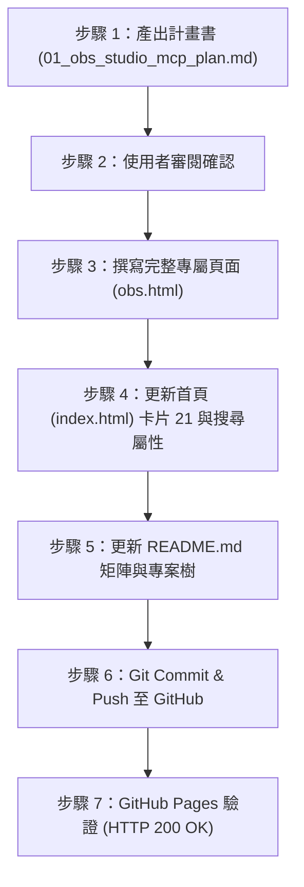

# 【Antigravity 擴充工具庫指南】本機軟體第 1 棒：OBS Studio MCP 實戰指南開發計畫書

- **專案代號**：`DESKTOP-MCP-01-OBS`
- **負責工具**：OBS Studio (Open Broadcaster Software)
- **對應頁面**：`obs.html`
- **首頁卡片**：Card 21 (`index.html`)
- **建立日期**：2026-11-24
- **當前版本**：v1.0.0 (計畫草案)
- **狀態**：規劃中 / 待審查與實裝

---

## 一、專案背景與整合價值

### 1.1 為什麼將 OBS Studio 列為本機軟體第一棒？
OBS Studio 是全球開源社群最普及、功能最強大的本機影像錄製與直播推流軟體。不論是線上課程錄製、軟體產品 Demo、遊戲實況、跨國視訊會議排版，還是電商直播帶貨，OBS 都是不可撼動的業界標準。

相較於其他桌面軟體，OBS Studio 具有極大的整合優勢：
1. **100% 免安裝額外外掛**：OBS Studio 28.0+ 起，已將 `obs-websocket 5.x` 核心協議原生整合進主程式，使用者不需手動尋找、編譯或下載第三方 Plugin，只需在設定中勾選「啟用 WebSocket」即可通訊。
2. **通訊架構極為成熟穩定**：基於業界標準的 WebSocket JSON-RPC 通訊，支援高速事件訂閱（如推流中斷、按鍵觸發、場景切換），本機調用毫秒級響應。
3. **AI 智慧導播閉環**：AI 不僅能透過指令編排複雜的畫中畫 (PiP)、視窗擷取來源與音訊軌道，還能調用視訊截圖功能，檢查畫布元素是否有遮擋、文字是否爆版，達成「指令操控 ➔ 畫布截圖 ➔ 自我調校」的智慧導播閉環。

---

## 二、使用者基本條件與環境需求 (User Prerequisites)

使用者在使用 OBS Studio MCP 前，需確保其設備與工作環境滿足以下條件：

| 項目類別 | 規格與基本條件 | 說明與備註 |
| :--- | :--- | :--- |
| **軟體主程式** | **OBS Studio 28.0 或更高版本**（推薦 30.x+） | 官方免費開源，內建 WebSocket 5.0+ 伺服器，免手動安裝外掛。 |
| **執行環境** | **Node.js 18+**（執行 `@royshil/obs-mcp`）或 **Python 3.10+ / uv**（執行 `obs-mcp`） | 提供標準 stdio MCP 伺服器運行環境。 |
| **作業系統** | Windows 10/11 64-bit、macOS (Apple Silicon / Intel)、或 Linux (Ubuntu 22.04+) | 跨平台全面支援。 |
| **硬體規格** | 建議 8GB+ RAM，具備硬體編碼支援（NVIDIA NVENC / AMD AMF / Apple Silicon VideoToolbox / Intel QuickSync） | 可確保 1080p 60fps / 4K 錄製推流時 CPU 不卡頓。 |
| **AI 客戶端** | Antigravity 2.0、Claude Desktop、Cursor、或相容 MCP 協議之 AI Agent | 建議搭配具備 Vision 視覺理解能力之 LLM（如 Gemini 2.0 / Claude 3.5 Sonnet），以實現視訊截圖自檢。 |
| **網路與通訊安全** | 本機環回位址 `127.0.0.1:4455`，支援密碼身分驗證 | 僅在本機沙盒內部傳遞控制信號，無外網暴露資安風險。 |
| **技能門檻** | **零程式碼（Zero-Code）** | 使用者無需記憶 OBS 複雜的快捷鍵或腳本語法，完全以自然語言對話操控。 |

---

## 三、系統架構與技術通訊協議

```mermaid
flowchart LR
    subgraph AI Client [AI 代理環境]
        Agent["AI Agent<br>(Claude / Gemini)"]
    end

    subgraph MCP Bridge [MCP 橋接層]
        MCPServer["OBS MCP Server<br>(@royshil/obs-mcp 或 obs-mcp)"]
    end

    subgraph OBS Desktop [本機 OBS 核心]
        WS["obs-websocket 5.x<br>(ws://127.0.0.1:4455)"]
        Engine["OBS Core Engine<br>(Scenes / Sources / Audio)"]
        Outputs["視訊輸出<br>(本地錄影 / 虛擬相機 / RTMP 串流)"]
    end

    Agent <-->|stdio (JSON-RPC)| MCPServer
    MCPServer <-->|WebSocket 協定 (RPC v5)| WS
    WS <--> Engine
    Engine --> Outputs
```

### 3.1 本機設定範例 (`antigravity.json` / `claude_desktop_config.json`)

```json
{
  "mcpServers": {
    "obs": {
      "command": "npx",
      "args": ["-y", "@royshil/obs-mcp"],
      "env": {
        "OBS_WEBSOCKET_URL": "ws://localhost:4455",
        "OBS_WEBSOCKET_PASSWORD": "your_secure_password"
      }
    }
  }
}
```

---

## 四、核心工具架構（5 大類工具矩陣）

| 工具群組名稱 | 關鍵 Tool 名稱 | 參數型別與欄位 | 功能說明 |
| :--- | :--- | :--- | :--- |
| **1. 場景控制** | `obs_scenes_list`<br>`obs_scenes_set_current_program`<br>`obs_scenes_create` | `sceneName: string` | 查詢所有場景清單、即時平滑切換主畫面場景、動態建立全新場景。 |
| **2. 來源與視窗排版** | `obs_sources_create`<br>`obs_scene_items_set_enabled`<br>`obs_scene_items_set_transform` | `sceneName, sourceName, visible, position, scale` | 動態新增視窗擷取、攝影機鏡頭、投影片來源；調整畫中畫 (PiP) 座標與縮放；隱藏/顯示圖層。 |
| **3. 推流與錄影錄音** | `obs_recording_start`<br>`obs_recording_stop`<br>`obs_streaming_start`<br>`obs_streaming_stop` | `muteAudio?: boolean` | 自動開始/暫停/停止本機高畫質錄影，或啟動 YouTube / Twitch RTMP 串流與虛擬攝影機 (Virtual Cam)。 |
| **4. 混音與音軌管理** | `obs_audio_set_volume`<br>`obs_audio_mute`<br>`obs_audio_get_volume` | `sourceName: string, volumeDb: number, mute: boolean` | 調節麥克風、桌面音效、背景音樂 (BGM) 之分貝音量，消除回音或一鍵靜音。 |
| **5. 畫布截圖與視覺自檢** | `obs_media_take_screenshot`<br>`obs_filters_set_enabled` | `sourceName?: string, quality?: number` | 擷取當前即時輸出畫布截圖回傳給 AI 模型，進行視覺排版稽核與濾鏡開關。 |

---

## 五、10 大跨角色實戰 Prompt 設計

| 編號 | 目標角色 | 核心情境 | 呼叫工具與亮點 |
| :---: | :--- | :--- | :--- |
| **01** | **線上同步教學教師** | 自動搭建「教學簡報 + 右下角圓形人像鏡頭 + 桌面教材」畫中畫場景 | `obs_scenes_create` + `obs_sources_create` |
| **02** | **遊戲實況主** | 遊戲啟動時自動切換至「滿版遊戲源」，並將聊天室浮動掛件置頂顯示 | `obs_scenes_set_current_program` + `obs_scene_items_set_transform` |
| **03** | **SaaS 產品經理** | 錄製 3 分鐘新功能示範影片，依演練段落自動切換視窗並在結尾自動停止錄影 | `obs_recording_start` + `obs_recording_stop` |
| **04** | **跨國遠距發表會主持** | 雙人對談分屏排版（左右各 50%），並依說話者動態淡入講者姓名標籤 | `obs_sources_create` + `obs_scene_items_set_enabled` |
| **05** | **影音播客 (Video Podcast)** | 偵測雙麥克風訊號，將背景襯樂音量自動壓低 (Ducking) 至 -18dB，人聲推至 0dB | `obs_audio_set_volume` |
| **06** | **虛擬 VTuber 實況團隊** | 載入透明通道綠幕相機源，套用色度去背 (Chroma Key) 濾鏡並校正羽化值 | `obs_filters_set_enabled` |
| **07** | **無障礙會議記錄員** | 於視訊畫面最下方常駐即時雙語字幕文字欄位，並於右側保留手語老師獨立視窗 | `obs_scene_items_set_transform` |
| **08** | **軟體 QA 自動化測試員** | 監聽 E2E 測試流程，當測試失敗報錯時自動快拍當前 OBS 虛擬畫面留下證據 | `obs_media_take_screenshot` |
| **09** | **電商直播企劃** | 一鍵切換「爆款特賣」熱潮場景，開啟倒數計時搶購字卡並調高歡慶音效 | `obs_scenes_set_current_program` + `obs_audio_set_volume` |
| **10** | **AI 智慧導播總監** | 擷取即時視訊畫布截圖，檢查人物視窗是否遮蔽簡報重點文字，若有遮蔽則自動位移至左下角 | `obs_media_take_screenshot` ➔ **視覺閉環自修** |

---

## 六、網頁視覺風格與體驗設計 (`obs.html`)

1. **視覺調色盤（OBS 專屬主題）**：
   - 核心基底：深藍夜空黑 (`#0B0F19` / `bg-slate-950`)
   - 品牌高光：科技青藍 (`#06B6D4` / `cyan-400`) 代表串流數據流
   - 警示/錄影點綴：錄影經典熾熱紅 (`#EF4444` / `rose-500`) 代表 Live 廣播狀態
2. **版面架構**：
   - 麵包屑導航：`首頁 / OBS Studio 直播錄影與 AI 智慧導播指南`
   - 左側側邊欄：7 大快速跳轉目錄（功能概述、使用者條件、核心能力、工具架構、10 大實戰 Prompt、外掛設定、FAQ）
   - 10 組實戰 Prompt 卡片：提供單鍵複製、Toast 回饋、預期產出與視覺成效說明
   - 設定教學：圖文說明 OBS 28+ 內建 WebSocket 勾選方式與通訊埠 4455 設定
3. **整合首頁 (`index.html`)**：
   - 標題升級：`21 大旗艦工具完整版`
   - 卡片 21：新增 OBS Studio 專屬玻璃字卡 (`data-category="automation design"`，青藍/深紫霓虹光暈)
   - 頁尾與搜尋索引即時連動

---

## 七、交付里程碑與執行計畫



---

**審查簽核**：
- 撰寫代理：Antigravity Agent (Google DeepMind Team)
- 審核者：使用者 (USER)
- 下一步：使用者確認計畫後，即刻動工實裝 `obs.html` 與相關系統更新。
