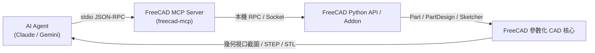

# 【Antigravity 擴充工具庫指南】本機軟體第 2 棒：FreeCAD MCP 實戰指南開發計畫書

- **專案代號**：`DESKTOP-MCP-02-FREECAD`
- **負責工具**：FreeCAD (開源參數化 3D 實體 CAD 建模系統)
- **對應頁面**：`freecad.html`
- **首頁卡片**：Card 22 (`index.html`)
- **建立日期**：2026-11-24
- **當前版本**：v1.0.0 (核准實裝)

---

## 一、專案背景與整合價值

### 1.1 為什麼將 FreeCAD 列為本機軟體第二棒？
FreeCAD 是開源世界中最主流的通用 3D 參數化實體 CAD（Computer-Aided Design）系統，廣泛應用於機械工程、零件製造、3D 列印創客與建築構件設計。

相較於 Blender 以網格（Polygon Mesh / Sub-D）雕刻與視覺渲染為核心，FreeCAD 專注於**精確工程約束（Parametric Constraints）、CSG 布林實體幾何與製造導向標準檔輸出（STEP、IGES、STL）**。
透過 MCP 整合：
1. **工程級自然語言參數化建模**：使用者無需手動繪製 2D 草圖拘束，僅需口述「長寬高 50x30x20mm，中心打孔直徑 10mm，四邊倒圓角 3mm」，AI 即可生成合規之 Part / PartDesign 實體。
2. **免手動調試 Python 腳本**：透過 MCP Server 與 FreeCAD 內部 Python API 聯動，精確建構幾何圖元。
3. **製造檔一鍵生成**：支援由文字直接觸發 STL（3D 列印）、STEP（CNC 加工）標準工程檔案匯出。

---

## 二、使用者基本條件與環境需求 (User Prerequisites)

| 項目類別 | 規格與基本條件 | 說明與備註 |
| :--- | :--- | :--- |
| **軟體主程式** | **FreeCAD 0.20、0.21 或 1.0+** | 官方免費開源，支援 Windows、macOS 與 Linux。 |
| **執行環境** | **Python 3.10+ / uv**（FreeCAD 內部內建 Python 環境） | 透過 `uvx freecad-mcp` 或 RPC 擴充套件啟動。 |
| **硬體規格** | 最低 8GB RAM（推薦 16GB 以上，複雜零件 CSG 布林運算需要運算記憶體） | 支援 OpenGL 3.0+ 顯示卡即可順暢預覽幾何視圖。 |
| **AI 客戶端** | Antigravity 2.0、Claude Desktop、Cursor 等 | 具備多模態視覺模型（Claude 3.5 Sonnet / Gemini 2.0 / GPT-4o）可讀取視圖快照驗證倒角與孔洞。 |
| **網路與通訊安全** | 本機環回 RPC 通訊埠 `127.0.0.1:9000` 或內部 stdio 管道 | 完全沙盒封閉運行，無外部連網隱私疑慮。 |
| **技能門檻** | **零 CAD 程式基礎** | 零代碼輸入長寬幾何參數，由 AI 自主組裝 CAD 節點特徵樹。 |

---

## 三、系統架構與技術通訊協議

---

## 四、核心工具架構（5 大核心工具）

1. `freecad_create_primitive`: 建立標準幾何體（立方體 Box、圓柱體 Cylinder、球體 Sphere、圓錐體）。
2. `freecad_run_code`: 執行 FreeCAD Python 腳本（`Part`, `Sketcher`, `PartDesign` 特徵操作）。
3. `freecad_export_file`: 將當前模型匯出為 `.stl` (3D 列印) 或 `.step` (工程通用格式)。
4. `freecad_get_document_info`: 獲取文件內的幾何物件清單、特徵樹階層與體積/表面積物理統計。
5. `freecad_get_view_screenshot`: 擷取當前 3D 視圖等角軸測圖 (Isometric View) 回傳給視覺 AI。

---

## 五、10 大跨角色實戰 Prompt 設計
1. **3D 列印創客**：參數化建立帶螺紋與散熱孔之樹莓派保護外殼，並匯出水密 STL。
2. **機械工程師**：建立符合 ISO 規格的直齒圓柱齒輪（Gear）與鍵槽軸孔。
3. **工業產品造型師**：圓潤雙向倒角手持吸塵器人體工學手柄設計。
4. **木工自造者 (Woodworker)**：建立傳統木工榫卯結構（鳩尾榫 Dovetail Joint）精確接合件。
5. **機器人機構架構師**：六軸機械手臂末端夾爪安裝法蘭盤（Flange）與減重偷輕凹槽。
6. **建築構件設計師**：標準化鋼結構 I 型鋼梁 (I-Beam) 與穿孔螺栓連接板。
7. **逆向工程分析師**：依據三坐標量測點座標重建曲面實體幾何。
8. **注塑模具工程師**：為主機外殼自動生成 2 度拔模斜度 (Draft Angle) 與加強肋骨 (Ribs)。
9. **大學機電系教授**：自動生成包含基準面 (Datum Plane) 與約束草圖之標準 CAD 教材範例。
10. **AI 幾何自檢工程師**：調用截圖與拓撲資訊，檢查是否有壁厚小於 1.2mm 之破面並動態加厚。

---

## 六、頁面視覺規範
- 主題色彩：工業深緋紅 (`#dc2626` / `red-600`) 與金屬鈦灰 (`#334155`)。
- 交付檔案：`freecad.html`、`index.html` (Card 22)。
