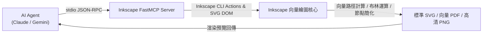

# 【Antigravity 擴充工具庫指南】本機軟體第 5 棒：Inkscape MCP 實戰指南開發計畫書

- **專案代號**：`DESKTOP-MCP-05-INKSCAPE`
- **負責工具**：Inkscape (開源向量繪圖與標準 SVG 編輯中樞)
- **對應頁面**：`inkscape.html`
- **首頁卡片**：Card 25 (`index.html`)
- **建立日期**：2026-11-24
- **當前版本**：v1.0.0 (核准實裝)

---

## 一、專案背景與整合價值

### 1.1 為什麼將 Inkscape 列為本機軟體第五棒？
Inkscape 是全球開源社群最旗艦的向量幾何繪圖軟體，深度遵循 W3C 官方標準可縮放向量圖形（Scalable Vector Graphics, SVG）格式，广泛應用於企業 LOGO、向量圖標、雷射切割 (Laser Cutting)、字型設計與學術出版圖表。

透過 MCP 與 Inkscape 命令行引擎與 SVG DOM 橋接：
1. **精準向量數學與布林運算**：AI 代理能精確計算幾何路徑座標、貝茲曲線（Bézier Curves），執行聯集 (Union)、差集 (Difference)、交集 (Intersection) 與路徑簡化 (Simplify)。
2. **無損縮放與代碼級乾淨輸出**：產出的 SVG 代碼乾淨無多餘垃圾標籤，可直接嵌入 Web 前端代碼或供雷射切割機精準讀取。
3. **多格式批次向量導出**：支援指令一鍵匯出高解析度向量 PDF、透明 PNG、EPS 或 DXF 工業繪圖格式。

---

## 二、使用者基本條件與環境需求 (User Prerequisites)

| 項目類別 | 規格與基本條件 | 說明與備註 |
| :--- | :--- | :--- |
| **軟體主程式** | **Inkscape 1.2 或 1.3+**（推薦官方最新穩定版） | 官方免費開源，支援 Windows、macOS 與 Linux。 |
| **執行環境** | 本機命令列可呼叫 `inkscape` 指令 + Python 3.10+ / FastMCP | 無需任何商業外掛授權。 |
| **硬體規格** | 最低 4GB RAM（推薦 8GB+，向量節點數超過數千時運算更流暢） | 一般內顯即可順暢處理。 |
| **AI 客戶端** | Antigravity 2.0、Claude Desktop、Cursor 等 | 具備多模態視覺模型可預覽向量渲染圖並調整幾何比例。 |
| **網路與通訊安全** | 本機 CLI 標準輸入輸出 stdio 管道 | 完全離線運行，保護向量商標智慧財產權。 |
| **技能門檻** | **零向量繪圖經驗** | 使用者口述幾何圖形意圖，由 AI 自動轉換為精確 SVG 幾何路徑。 |

---

## 三、系統架構與技術通訊協議

---

## 四、核心工具架構（5 大核心工具）

1. `inkscape_create_path`: 依據幾何座標建立矩形、圓形、多邊形與貝茲曲線路徑。
2. `inkscape_boolean_operation`: 執行路徑聯集 (Union)、相減差集 (Difference) 與交集。
3. `inkscape_transform_node`: 調整節點控制柄、平移、旋轉、等比例縮放幾何物件。
4. `inkscape_query_svg_dom`: 檢索 SVG 檔案內部的群組 (Group)、圖層 (Layer) 與樣式 CSS。
5. `inkscape_export_format`: 將向量文件匯出為透明 PNG、列印級向量 PDF 或 DXF 格式。

---

## 五、10 大跨角色實戰 Prompt 設計
1. **企業識別 (CIS) 設計師**：黃金比例圓弧建構極簡幾何科技企業商標 LOGO。
2. **向量圖示 (Icon) 繪師**：24x24 網格系統繪製 6 款線性 (Outlined) 系統導航圖標。
3. **雷射切割創客 (Maker)**：建立壓克力卡榫收納盒展開圖（紅線切割 0.01mm，藍線雕刻）。
4. **包裝結構工程師**：繪製折疊紙盒刀模線 (Die-line)，包含出血位 (Bleed) 與壓痕虛線。
5. **學術論文圖表繪製員**：製作符合 Nature 期刊規範的多組柱狀與折線統計圖，包含清晰座標刻度。
6. **字體字型設計師**：設計一組粗體幾何展示英文字型（Display Font）之核心字母「A, B, C」。
7. **地圖空間標註員**：在建築平面圖上繪製向量逃生路線動線箭頭與消防設施圖例。
8. **文創周邊印務人員**：為異形貼紙設計外擴 2mm 之平滑白墨保護邊框向量路徑。
9. **資訊圖表 (Infographic) 視覺師**：自動建立三階段商業飛輪循環流程圖與漸層箭頭。
10. **AI 向量拓撲自檢工程師**：掃描 SVG 路徑，自動清除重疊節點並將非封閉路徑進行閉合焊接。

---

## 六、頁面視覺規範
- 主題色彩：Inkscape 經典黑金琥珀色 (`#f59e0b` / `amber-500`、`#d97706` / `amber-600`)。
- 交付檔案：`inkscape.html`、`index.html` (Card 25)。
