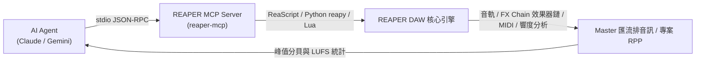

# 【Antigravity 擴充工具庫指南】本機軟體第 6 棒：REAPER DAW MCP 實戰指南開發計畫書

- **專案代號**：`DESKTOP-MCP-06-REAPER`
- **負責工具**：REAPER DAW (頂級輕量極致專業數位音訊工作站)
- **對應頁面**：`reaper.html`
- **首頁卡片**：Card 26 (`index.html`)
- **建立日期**：2026-11-24
- **當前版本**：v1.0.0 (核准實裝)

---

## 一、專案背景與整合價值

### 1.1 為什麼將 REAPER DAW 列為本機軟體第六棒？
REAPER（Rapid Environment for Audio Production, Engineering, and Recording）是全球專業音樂人、Podcast 製作人、電影混音師與遊戲音效師公認效能最高、最靈活的專業數位音訊工作站（DAW）。其安裝包僅 15MB 左右，卻擁有破千種可程式化擴充能力（ReaScript、Python API、Lua、C++）。

透過 MCP 與 REAPER 橋接：
1. **超過百項音訊工程自動化**：AI 可一鍵建立音軌、掛載 VST/AU 效果器（EQ 等化器、Compressor 壓縮器、Reverb 殘響）、設定音量推桿 (Fader) 與立體聲相位 (Pan)。
2. **語音與 Podcast 智慧後製**：自動執行語音去噪、消除爆音、自動匹配廣播響度標準（LUFS -16 / -14）並標註章節標記 (Markers)。
3. **MIDI 編曲與母帶工程導出**：自然語言指示生成和弦進行、掛載合成器音源，並一鍵無損渲染導出 WAV / FLAC。

---

## 二、使用者基本條件與環境需求 (User Prerequisites)

| 項目類別 | 規格與基本條件 | 說明與備註 |
| :--- | :--- | :--- |
| **軟體主程式** | **REAPER 6.x 或 7.x+**（Windows / macOS / Linux 全平台） | 具備極其寬鬆完整的試用機制，極度輕量不佔資源。 |
| **外掛與擴充套件** | SWS Extension（官方社群推薦外掛）+ Python / ReaScript 支援 | 提供高階音訊巨集與 MCP 伺服器橋接通訊。 |
| **硬體規格** | 最低 4GB RAM（多軌大專案推薦 8GB+） | 支援低延遲音訊驅動（ASIO / CoreAudio）。 |
| **AI 客戶端** | Antigravity 2.0、Claude Desktop、Cursor 等 | 可讀取音軌狀態與頻譜分貝分析數值。 |
| **網路與通訊安全** | 本機 WebSocket / Socket 或常駐本機 Daemon | 封閉於本機沙盒內部，保障商業音樂母帶版權安全。 |
| **技能門檻** | **新手～專業錄音工程師皆宜** | 聲音愛好者可口述修音需求，專業混音師可用於批次處理海量音軌。 |

---

## 三、系統架構與技術通訊協議

---

## 四、核心工具架構（5 大核心工具）

1. `reaper_create_track`: 建立音軌、設定音軌顏色、立體聲/單聲道輸入路由。
2. `reaper_add_fx_plugin`: 為指定軌道插入 VST/AU 效果器（如 ReaEQ, ReaComp, Ozone）並調參數。
3. `reaper_insert_midi_notes`: 在指定時間軸區段寫入 MIDI 音符、力度 (Velocity) 與和弦。
4. `reaper_set_track_volume_pan`: 調整推桿音量分貝 (dB)、左右聲道立體聲分佈與靜音 (Mute/Solo)。
5. `reaper_render_project`: 批次或選區渲染輸出 WAV/MP3，並設定採樣率 (48kHz/24bit) 與 LUFS 目標。

---

## 五、10 大跨角色實戰 Prompt 設計
1. **Podcast 剪輯後製師**：清理雙人訪談音軌，自動壓制環境底噪並將整體整合響度平衡至 -16 LUFS。
2. **影視配樂作曲家**：建立 4 軌弦樂組（第一小提琴、第二小提琴、中提琴、大提琴）並寫入憂傷 D 小調和弦。
3. **獨立樂團混音師**：為爵士鼓組音軌建立子混音匯流排 (Drum Bus)，掛載總線壓縮器並提升 Punch 感。
4. **遊戲音效 (SFX) 設計師**：將雷射槍音效進行音高降低 12 半音 (Pitch Shift) 並疊加金屬殘響效果。
5. **母帶後期工程師**：在 Master 軌道掛載磚牆限制器 (Limiter)，設定 True Peak 不超過 -1.0 dBTP。
6. **語音導航配音員**：自動偵測錄音中的靜音段落，將停頓超過 0.8 秒處一鍵精準裁切。
7. **EDM 電音製作人**：為合成器 Lead 音色設計 4 小節側鏈 (Sidechain) 抽吸節奏特效。
8. **有聲書工程師**：將章節標題寫入 REAPER Timeline 標記 (Markers)，並一鍵依據 Marker 批次分割切檔。
9. **現場收音除噪專員**：在領夾麥克風軌道掛載 ReaFIR 頻譜反相濾波器，消除 60Hz 交流電蜂鳴聲。
10. **AI 頻譜平衡自檢工程師**：掃描所有音軌頻譜能量分佈，自動衰減 300Hz 處渾濁 (Muddy) 頻段 2.5dB。

---

## 六、頁面視覺規範
- 主題色彩：專業音訊波形翡翠綠 (`#10b981` / `emerald-500`、`#059669` / `emerald-600`)。
- 交付檔案：`reaper.html`、`index.html` (Card 26)。
