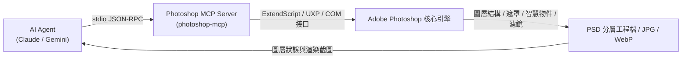

# 【Antigravity 擴充工具庫指南】本機軟體第 7 棒：Adobe Photoshop MCP 實戰指南開發計畫書

- **專案代號**：`DESKTOP-MCP-07-PHOTOSHOP`
- **負責工具**：Adobe Photoshop (全球商業圖像處理與數位修圖標竿)
- **對應頁面**：`photoshop.html`
- **首頁卡片**：Card 27 (`index.html`)
- **建立日期**：2026-11-24
- **當前版本**：v1.0.0 (核准實裝)

---

## 一、專案背景與整合價值

### 1.1 為什麼將 Adobe Photoshop 列為本機軟體第七棒？
Adobe Photoshop 是全球創意設計、商業攝影修圖、數位繪畫與社群視覺行銷領域絕對的壟斷級旗艦軟體。從 PSD 分層檔案、智慧型物件 (Smart Objects)、調整圖層 (Adjustment Layers) 到遮罩選區，是幾乎所有專業視覺設計師的日常工作台。

透過 MCP 與 Photoshop 本機橋接（ExtendScript / UXP / COM / WebSocket）：
1. **複雜圖層樹結構自動化**：AI 代理能精確建立圖層組 (Layer Group)、為特定圖層添加向量遮罩 (Layer Mask)、自動鎖定背景層並重命名圖層。
2. **商業修圖與調色自動化**：支援自動套用色階 (Levels)、曲線 (Curves)、色相/飽和度 (Hue/Saturation) 調整層，並無損修改數值。
3. **電商與社群全通路批次重構輸出**：一次性將主視覺畫布依據規格切分為 IG 貼文 (1:1)、限時動態 (9:16) 與官網 Banner (16:9)，並輸出 WebP / PNG 高壓縮比圖檔。

---

## 二、使用者基本條件與環境需求 (User Prerequisites)

| 項目類別 | 規格與基本條件 | 說明與備註 |
| :--- | :--- | :--- |
| **軟體主程式** | **Adobe Photoshop 2021 (v22.0) 至 2024 / 2025 (v26.x+)** | 支援 Windows 10/11 與 macOS (Apple Silicon 原生加速)。 |
| **外掛與橋接環境** | 本機 `photoshop-mcp` (Node.js/npm 或 Python API) | 透過本機 WebSocket 或 Windows COM 接口與 PS 核心通訊。 |
| **硬體規格** | 建議 16GB+ RAM（多圖層大型 PSD 檔推薦 32GB RAM） | 具備獨立顯卡支援 GPU 影像加速。 |
| **AI 客戶端** | Antigravity 2.0、Claude Desktop、Cursor 等 | 具備多模態視覺模型可審查修圖前後對比效果。 |
| **網路與通訊安全** | 本機環回位址 `127.0.0.1` 沙盒通訊 | 僅限本地調用，保護商業設計智慧財產權與客戶機密素材。 |
| **技能門檻** | **零快捷鍵門檻** | 無需手動記憶幾百種 PS 工具與鋼筆錨點，口述即成專業圖層。 |

---

## 三、系統架構與技術通訊協議

---

## 四、核心工具架構（5 大核心工具）

1. `ps_open_create_document`: 開啟現有 PSD 檔或新建指定像素長寬與色彩模式 (RGB/CMYK) 畫布。
2. `ps_add_layer_mask`: 建立圖層、智慧物件，並為圖層附加黑白反向遮罩或選區。
3. `ps_apply_adjustment_filter`: 掛載色相飽和度、曲線、高斯模糊 (Gaussian Blur) 等無損調整圖層。
4. `ps_batch_export_assets`: 批次匯出特定圖層或畫板 (Artboards) 為 JPG, PNG, WebP。
5. `ps_get_document_layers`: 抓取當前 PSD 內所有圖層名稱、可見度、鎖定狀態與混合模式階層。

---

## 五、10 大跨角色實戰 Prompt 設計
1. **電商產品精修師**：為商品圖去除反光灰塵，建立柔和投影圖層並提升金屬光澤對比度。
2. **社群廣告 Banner 設計師**：搭建 1080x1080 正方形促銷貼文，排版主標題、副標題與 CTA 搶購按鈕。
3. **電影海報主視覺設計師**：合成主角人像與末日城市背景，套用「青橙色調 (Teal & Orange)」電影色彩。
4. **UI 設計師 (App Redesign)**：將低保真線框草圖轉換為 3x 密度 Retina 高清晰度介面圖層組。
5. **風格攝影師**：為婚禮紀實人像套用柔焦漫射 (Orton Effect) 與暖調膚色校正曲線。
6. **多尺寸橫幅自動批次輸出師**：將主視覺延伸生成 3 組常用規格（1200x628, 1080x1920, 800x800）。
7. **服裝模特兒換裝設計師**：建立衣物邊緣精確選區遮罩，套用色相調整層快速預覽 5 種服裝顏色。
8. **實體印刷印前製版員**：將 RGB 檔案轉為 CMYK 印刷模式，設定 3mm 出血線與黑版 (K 100%) 陷印。
9. **文字排版主美 (Art Director)**：為 3D 浮雕大標題添加斜角與浮雕 (Bevel & Emboss) 及雙重漸層疊加圖層樣式。
10. **AI 圖層結構自檢工程師**：檢查 PSD 檔案，將所有「未命名圖層」自動依據內容歸類重命名並分組打包。

---

## 六、頁面視覺規範
- 主題色彩：經典 Adobe Photoshop 湛藍色 (`#0284c7` / `sky-600`、`#38bdf8` / `sky-400`)。
- 交付檔案：`photoshop.html`、`index.html` (Card 27)。
